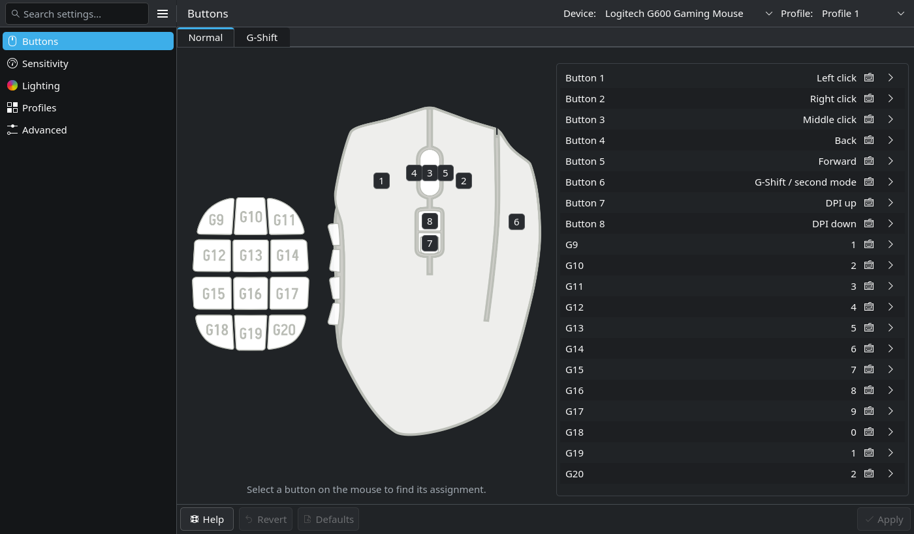
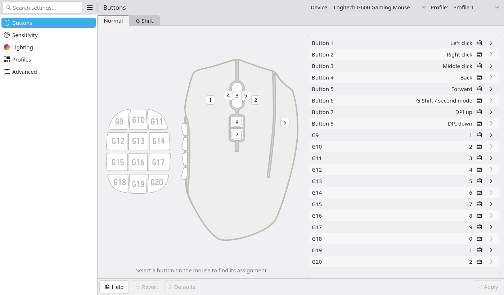
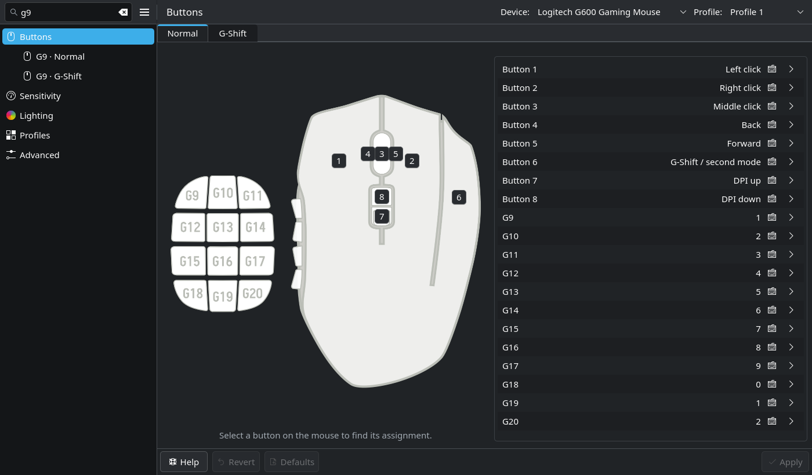
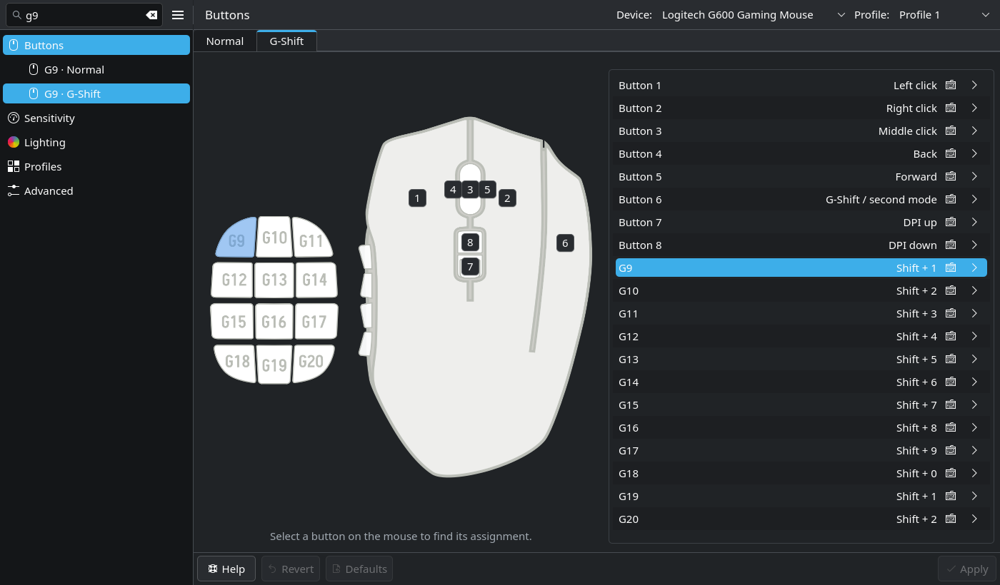
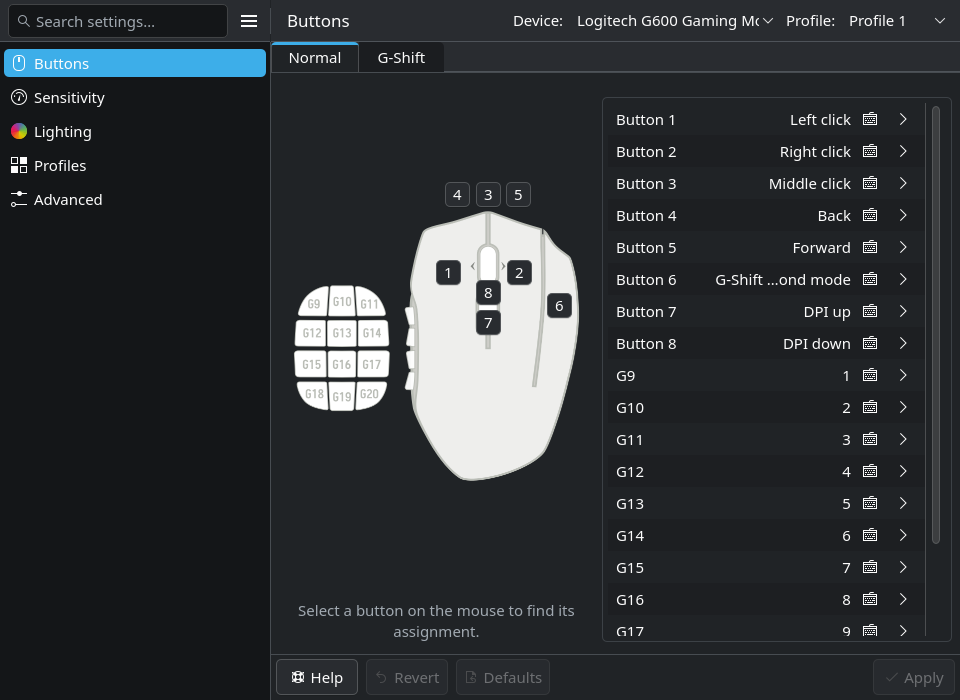

# Piper Kirigami prototype

> **ACTIVE DEVELOPMENT.** This project is under active development and is not accepting issues or pull requests. Please do not submit bug reports, feature requests or contribution PRs at this stage. This project policy does not change the rights granted by its free-software licenses.

A native **Qt 6 / KDE Kirigami** mouse-configuration frontend using ratbagd's D-Bus API and Piper's original device artwork. This is an experimental parallel frontend, not an official Piper release or a finished replacement for GTK Piper.



## What works

- Select a mouse diagram target to highlight and reveal its assignment. Use the trailing arrow to open an in-window assignment settings page, or the keyboard action to record a shortcut directly in the row; Enter on the focused diagram opens the selection. Lighting targets still open their editors directly. Normal/G-Shift tabs span the diagram and assignment list within the Buttons page, and compact assignment rows keep the current mapping right-aligned. Assignments use one compact column at every width and scroll when needed.
- Capability-aware mouse/key/special/macro assignments, DPI stages, polling, lighting zones, on-device profiles, angle snapping and debounce.
- Assignment child pages offer a full-width visual event list. Quick chord recording stays on the main Buttons overview. Add… configures a new immutable event in a searchable native picker; confirm with OK, then reorder or remove events in the list. Direct keyboard/mouse assignments also use searchable value pickers. Invalid or device-unencodable sequences remain local and block Apply; canceling a picker makes no change.
- Scoped local drafts, asynchronous ratbagd writes, reconnect/error states and unsaved-navigation protection. Main Buttons Revert/Apply affects pending assignments in the selected profile. Each child assignment and settings page has its own Reset/Apply scope.
- Native KDE-style sidebar navigation, Kirigami components, KDE desktop controls, Breeze icons and light/dark schemes. The search/navigation pane and section/content pane have separate Kirigami headers and an aligned divider, following the public-component structure used by KDE System Settings.
- Search sections or individual assignments using the top-left search field (Ctrl+F). Matching buttons appear as compact submenu entries under Buttons, with minimal Normal/G-Shift context. Activation switches layer and reveals the assignment without dismissing the query or results. Results follow the selected device/profile; changing or clearing the query updates them.

The G600 fixture models its actual restrictions: reserved index 20 is excluded; shifted assignments use indices 21–40; unsupported profile renaming, stage disabling, independent X/Y DPI and LED brightness are disabled. Its macro support is limited to a single encodable non-modifier key with modifiers, including the reserved-zero representation of a modifier-only chord. Unencodable G600 keycodes are rejected; LED effect durations use whole seconds from 0 to 15. The separate generic fixture exercises broader daemon capabilities.

## Run from source

Use Python 3.10+ and distribution packages for **PySide6, Qt Quick Controls 2, Qt SVG, Kirigami, KDE QQC2 Desktop Style, Breeze style/icons/color schemes, dbus-next and ratbagd**. Qt/PySide6 and the system KDE modules must use compatible Qt minor-version ABIs. Do not combine arbitrary pip Qt wheels with unrelated system QML plugins. The development runtime used Qt/PySide6 6.8.2.

```sh
./run-qt.sh --mock              # deterministic G600 and capability-test fixtures
./run-qt.sh --mock --dark       # Breeze Dark
./run-qt.sh                     # real system-bus ratbagd; no mock fallback
./run-qt.sh --mock --headless --screenshot preview.png
```

`requirements-qt.txt` lists Python dependencies for controlled virtual environments; Kirigami/Breeze are system dependencies, not pip packages. `PIPER_KIRIGAMI_QML_PATH` may override the QML import path. A local `.deps` directory is optional and is not distributed.

Without `--mock`, ratbagd must be running and permit device access. The frontend does not access raw HID/input devices or request root. Applying real changes submits them to ratbagd; it does not certify firmware persistence. Although the frontend limits which properties it stages, ratbagd Commit is device-wide. Known daemon dirtiness and stale/conflicting drafts block Apply; another external client can still race the preflight check. Driver reserialization may also affect firmware fields/actions that ratbagd cannot represent. Read-only comparison does not prove lossless physical writes; preserve a rollback snapshot and validate supported changes on the target device before relying on them.

## Build an installable package

```sh
meson setup build-qt qt-build --prefix=/usr
DESTDIR="$PWD/stage" meson install -C build-qt
```

The separate `piper-kirigami` launcher and `org.freedesktop.Piper.Kirigami.desktop` entry coexist with GTK Piper. Do not run an unstaged system install unless you intend to install the prototype.

See [PACKAGING.md](PACKAGING.md) for the primary x86_64 development Flatpak targeting KDE 6.11 on Fedora 44/Bazzite, plus optional RPM packaging and CI artifacts for downstream image integration. Python/QML is packaged as a **noarch application**, not represented as a natively compiled executable. CI artifacts are prototypes, not stable releases.

## Offline help

Press F1 or choose Piper Handbook from the menu for the packaged offline guide, including navigation, mapping/macros, DPI, lighting, profiles, troubleshooting and verification limits. The native help window supports search and clickable contents. See the [HIG review](docs/HIG-REVIEW.md) and [help integration](docs/HELP-INTEGRATION.md) for the honest boundary between this in-app guide and future host KHelpCenter registration.

Normal startup preserves the platform font, palette and style; explicit `--dark` and mock previews can use Breeze overrides. Live desktop/portal theme integration still needs installed-platform testing.

## Screenshots

These are actual rendered windows using synthetic ratbagd fixtures, not physical-device captures.

### Reviewed main-page design

The current Buttons page uses full-width Normal/G-Shift tabs, a compact assignment list, persistent sidebar search, and two trailing row actions with scoped Help / Revert / Defaults / Apply controls.

**Breeze Light**



**Persistent search and selected G-Shift assignment**





**Narrow desktop layout**



The dark overview at the top of this README shows the same main-page design.

### Work in progress

The other settings pages and assignment-editor design still need visual/UX refinement. These links document implemented behavior; they are not part of the reviewed main-page gallery:

- [Assignment editor](docs/screenshots/kde-direct-binding-editor.png) and [Add-event picker](docs/screenshots/kde-add-event-picker.png)
- [Sensitivity](docs/screenshots/kde-dark-sensitivity.png), [profiles](docs/screenshots/kde-dark-profiles.png), [advanced](docs/screenshots/kde-dark-advanced.png): generic “Capability test mouse”
- [Lighting](docs/screenshots/kde-dark-lighting.png), [lighting editor](docs/screenshots/kde-dark-lighting-editor.png): G600; brightness is unsupported
- [Offline handbook](docs/screenshots/kde-handbook.png)

## Verification and limits

The sanitized source passes **126 tests plus 1,434 SVG subtests**, including **98 backend tests**, **5 handbook/recorder tests**, **1 platform-style test** and **12 packaging checks**. The backend suite uses an isolated D-Bus service and tests scoped writes, stale/conflicting contexts, G600 encoding and read-only picker validation.

Native UI verification passed a **20-scenario baseline** (3,946 real inputs), followed by four explicit-OK flow reruns (**502 inputs**) and four final picker/event/14-point/error-recovery checks (**902 inputs**), plus a final empty-state copy check (**12 inputs**). All reported zero QML warnings. A final four-group settings check passed **251 inputs**, also with zero QML warnings. Reports preserve the actual source hashes and revision boundaries; these are not presented as one unchanged full-suite run. Current screenshots were visually inspected. Ruff/Black, staged Meson installation and installed-tree mock startup also pass. See [verification evidence](docs/verification/).

The cloud development runtime uses Qt/PySide6 6.8.2. Read-only target checks used Qt/PySide6 6.11.2 and ratbagd 0.18/API 2: all 120 editable bindings across three G600 profiles matched the existing daemon state, without mouse changes. The target SDK icon lookup and real pixmap checks pass after correcting icon search paths. The earlier prototype’s device/profile/lighting selectors also passed real Wayland/KWin mouse and keyboard interaction on Qt 6.11.2. Qt 6.11 exposed a first-open native popup focus bug: the outer popup received keyboard events while its list lacked active focus. Native selectors now focus their popup content when opened. Package builds run interaction checks on an isolated Xvfb display; target validation of the latest child-page design remains required.

Actual Flatpak/RPM artifact builds and installed-package checks require a successful CI run. Prepared packaging and successful dependency probes alone do not establish a working release bundle.

```sh
xvfb-run -a -s "-screen 0 1600x1100x24" env QT_QPA_PLATFORM=xcb QT_QUICK_BACKEND=software python -m pytest -q tests/test_qt_diagrams.py tests/qt
xvfb-run -a -s "-screen 0 1600x1100x24" env QT_QPA_PLATFORM=xcb QT_QUICK_BACKEND=software python tools/verify-kde-ui.py --output evidence-kde
```

Tests require pytest/pytest-subtests and a private `dbus-daemon`; the integration suite starts an isolated loopback service. No test requires real mouse hardware. Historical QML baselines are retained solely for regression tests and are not installed.

**Not verified:** physical firmware persistence, actual RGB output, physical mouse behavior, full screen-reader accessibility, native Wayland/X11 integration and live desktop theme changes. Existing GTK translations have not been migrated; the prototype is English-only. Hardware-specific capabilities vary by ratbagd driver. Keyboard recording covers common Linux keys. The visual macro event panel provides supported key choices and device-aware validation; G600 cannot encode arbitrary keycodes or timed multi-key sequences.

Main Buttons Revert/Apply affects assignment drafts in the selected profile, across its Normal/G-Shift layers. A child assignment page resets/applies only its own assignment; Sensitivity, Lighting, Profiles and Advanced affect their documented settings in the selected profile. Unrelated drafts remain pending. Defaults is visible but disabled because authoritative restoration is not implemented. Its intended enablement is supported defaults plus a semantically differing current draft, never merely a dirty flag. See [Defaults scope](docs/DEFAULTS-SCOPE.md) for the documented per-assignment subset and whole-profile limitations. Published G600 preset mappings do not by themselves guarantee lossless restoration of every driver/firmware field. Switching the displayed Normal/G-Shift tab is immediate and does not change device settings.

Profiles currently means existing **on-device ratbagd slots**. Saved-profile library integration, profile import/export and cross-device profile management are not implemented. The settings pages use shared native forms, compact DPI groups and capability explanations. Layouts are checked at the supported 960×700 minimum size; dirty-state actions and keyboard navigation remain available.

## Upstream and licensing

Based on [libratbag/piper](https://github.com/libratbag/piper), snapshot `5d3c8845b55643595ccb8029dfa5c7a2fb079e77`. Original GTK source, translations and attribution are retained; [README-upstream.md](README-upstream.md) documents upstream. Historical upstream workflow definitions are retained under `upstream-reference/workflows/` rather than enabled as this project's CI.

The application code is GPL-2.0-or-later; see [COPYING](COPYING). Preserve per-file notices. Artwork retains its embedded licenses, including CC-BY-SA-4.0 notices on the G602/G604 assets. See [THIRD_PARTY_NOTICES.md](THIRD_PARTY_NOTICES.md). This project does not imply endorsement by KDE, Piper, Logitech or other device vendors.
